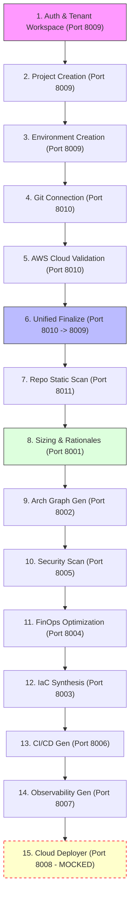
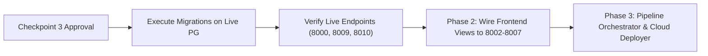

# AETHEROPS — MASTER APPLICATION HEALTH CHECK, MODULE AUDIT & GAP ANALYSIS

**Document Version:** 1.0  
**Audit Date:** 12 October 2026  
**Repository Path:** `/home/prathap32/GP/devops-lab/projects/aether-cloud`  
**Execution Mode:** Read-Only Dynamic Inspection & Controlled Local Probing  
**Branch:** `main` | **Git Commit HEAD:** `52bff81aee4e4a75a3e3a7da6f612ac6a95b23ea`  
**Audit Author:** Antigravity AI (Senior Software Architect & DevSecOps Lead)

---

## 1. EXECUTIVE SUMMARY

### 1.1 Overall Platform Health Verdict
The AetherOps codebase is in a **partially functional, highly structured microservices state**. All **12 microservices** boot successfully, listen on their designated ports (8000–8011), and return HTTP 200 on `/health`. The frontend React application is fully compiled (`frontend/dist`) and served through the central API Gateway (`admin_console` on port 8000).

However, an end-to-end user workflow currently encounters a **critical operational blocker on live PostgreSQL**: the code in `project_and_environment_management` (Port 8009) and `source_and_cloud_connection` (Port 8010) was updated during Phase 1 Checkpoints 2 & 2A to enforce multi-tenant isolation (`tenant_id`, `created_by_user_id`), but **live database migrations have not yet been applied to PostgreSQL (`aether_catalog`)**. As a result, live queries fail with `UndefinedColumnError: column aether_projects.tenant_id does not exist`.

### 1.2 Summary Scorecard
| Layer / Subsystem | Status | Pass Rate | Key Finding |
| :--- | :--- | :---: | :--- |
| **Fleet Infrastructure** | **ONLINE (12/12)** | 100% | All 12 services running, healthy socket bindings. |
| **Database Containers** | **ONLINE (2/2)** | 100% | PostgreSQL 15 & Redis 7 active in Docker. |
| **Unit & Service Tests** | **PASSED** | 171 / 171 (100%) | All 12 service isolated test suites pass. |
| **Migration Tooling** | **VERIFIED** | 2 / 2 (100%) | Reversible migration runner passes on test DBs. |
| **Live Database Schema** | **BLOCKED (Pre-Migration)** | 0% live | PostgreSQL schema lacks `tenant_id` columns. |
| **Frontend UI (Static)** | **COMPILED** | 100% | Single-domain SPA shell served on all clean URLs. |
| **Frontend API Binding** | **PARTIAL** | ~40% | Views 1–3 call real APIs; Views 4–8 use mock data. |
| **Downstream Engines** | **FUNCTIONAL** | 90% | IaC, FinOps, CI/CD, Observability work; Deployer is simulated. |

---

## 2. PLATFORM TOPOLOGY & SERVICE FLEET

AetherOps consists of **12 distinct backend microservices**, a central reverse proxy API gateway, and a single-page React frontend:

| Port | Service Identifier | Display Name | Storage Backend | Live Probe Status |
| :---: | :--- | :--- | :--- | :---: |
| **8000** | `admin_console` | Admin Console & Fleet Gateway | Redis + PG / SQLite catalogs | **ONLINE (HTTP 200)** |
| **8001** | `requirement_analysis` | Requirement Analysis Engine | SQLite `requirements.db` + 39 Catalogs | **ONLINE (HTTP 200)** |
| **8002** | `architecture_generator` | Architecture Graph Generator | Stateless | **ONLINE (HTTP 200)** |
| **8003** | `iac_generator` | IaC Code Synthesizer | Stateless | **ONLINE (HTTP 200)** |
| **8004** | `finops_optimizer` | FinOps Cost Arbitrage | Stateless / Catalog lookup | **ONLINE (HTTP 200)** |
| **8005** | `security_scanner` | Security & CIS Compliance | Stateless | **ONLINE (HTTP 200)** |
| **8006** | `cicd_pipeline` | GitOps CI/CD Pipeline Engine | Stateless | **ONLINE (HTTP 200)** |
| **8007** | `observability_setup` | Observability & APM Engine | Stateless | **ONLINE (HTTP 200)** |
| **8008** | `cloud_deployer` | Cloud Deployer & Drift Engine | State-locked (Simulated) | **ONLINE (HTTP 200)** |
| **8009** | `project_and_environment_management` | Project & Environment Manager | PG `project_manager` / SQLite fallback | **ONLINE (HTTP 200)** |
| **8010** | `source_and_cloud_connection` | Source & Cloud Connection | PG `source_connection` / SQLite fallback | **ONLINE (HTTP 200)** |
| **8011** | `repo_analyzer_service` | Source Code Static Analyzer | Stateless / Local filesystem | **ONLINE (HTTP 200)** |

---

## 3. MODULE-BY-MODULE AUDIT

### 3.1 Module: Admin Console & API Gateway (Port 8000)
- **Status:** **FUNCTIONAL (Gateway & Catalog Management)**
- **What Works:**
  - Serves compiled React frontend (`frontend/dist/index.html`) on all clean navigation URLs (`/`, `/projects`, `/environments`, `/source-connection`, etc.).
  - Asynchronous reverse proxy (`gateway_router.py`) correctly routes traffic:
    - `/api/v1/projects/*`, `/api/v1/auth/*` $\rightarrow$ Port 8009
    - `/api/v1/connections/*`, `/api/v1/cloud/*`, `/api/v1/github/*` $\rightarrow$ Port 8010
    - `/api/v1/repo/*`, `/api/v1/requirements/*` $\rightarrow$ Port 8001
    - `/api/v1/architecture/*` $\rightarrow$ Port 8002
    - `/api/v1/iac/*`, `/api/v1/terraform/*` $\rightarrow$ Port 8003
    - `/api/v1/finops/*` $\rightarrow$ Port 8004
    - `/api/v1/security/*` $\rightarrow$ Port 8005
    - `/api/v1/cicd/*` $\rightarrow$ Port 8006
    - `/api/v1/monitoring/*` $\rightarrow$ Port 8007
    - `/api/v1/deployments/*` $\rightarrow$ Port 8008
  - Catalog probing across AWS regions and Redis cache management work cleanly.
- **What Is Incomplete / Broken:**
  - When proxying `/api/v1/projects` to Port 8009, receives HTTP 500 from 8009 because PostgreSQL lacks the unmigrated `tenant_id` column.

### 3.2 Module: Project & Environment Management (Port 8009)
- **Status:** **PARTIAL / BLOCKED ON LIVE PG MIGRATION**
- **What Works:**
  - Authentication: Local password auth with bcrypt, JWT token generation, HttpOnly cookie setting.
  - Multi-tenant model: `Tenant`, `TenantMembership`, `AetherProject`, `AetherEnvironment`.
  - Automated personal workspace provisioning on user registration.
  - Role escalation prevention (Tenant `ADMIN` cannot assign `OWNER` or demote fellow `ADMIN`).
  - Unit/Isolation test suite: 41/41 tests pass (using SQLite / memory test harness).
- **What Is Broken:**
  - **Live PostgreSQL execution fails:** The production connection string points to `aether_catalog` schema `project_manager`. Because Checkpoint 3 migrations have not been applied to live PG, table `aether_projects` does not have `tenant_id` or `created_by_user_id`. Calling `GET /api/v1/projects` causes `asyncpg.exceptions.UndefinedColumnError: column aether_projects.tenant_id does not exist`.

### 3.3 Module: Source & Cloud Connection (Port 8010)
- **Status:** **PARTIAL / BLOCKED ON LIVE PG MIGRATION**
- **What Works:**
  - GitHub PAT validation (`/api/v1/github/verify-pat`) and OAuth initiation.
  - GitHub repository list, branch discovery, and file tree fetching via GitHub REST API.
  - AWS Credential Validation (`/api/v1/cloud/aws/validate`) via real AWS STS `GetCallerIdentity` or `AssumeRole`.
  - Unified finalize endpoint (`/api/v1/connections/finalize`) connecting both Git and Cloud in a single transaction.
  - HTTP bridge to Module 1 (`http://localhost:8009/api/v1/projects`) to advance environment status to `REPOSITORY_CONNECTED`.
  - Unit/Isolation test suite: 45/45 tests pass.
- **What Is Broken:**
  - Live PostgreSQL queries against `source_connection.git_connections` or `cloud_connections` fail when querying `tenant_id` before database migration.
  - Legacy AWS secret keys stored as bcrypt hashes cannot be decrypted without re-authentication (by design from Checkpoint 2).

### 3.4 Module: Repository Analyzer Service (Port 8011)
- **Status:** **FUNCTIONAL**
- **What Works:**
  - Static repo scan (`/api/v1/repo/scan`) using local AST / rules heuristics without calling external network or LLM.
  - Strict path traversal sanitization: rejects system directories (`/etc`, `/proc`, `/sys`), filesystem root `/`, and credential stores (`.ssh`, `.aws`, `.kube`).
  - Scan-and-size endpoint (`/api/v1/repo/scan-and-size`) forwards detected profile to Module 1 (`http://localhost:8001/api/v1/requirements/analyze-repo`).
  - All 11 path sanitization unit tests pass.

### 3.5 Module: Requirement Analysis Engine (Port 8001)
- **Status:** **FUNCTIONAL**
- **What Works:**
  - Deterministic workload sizing engine (`/api/v1/analyze`) with SQLite regional pricing partition lookup (39 AWS regions).
  - TOPSIS instance finder with Gaussian error function (`erf`) headroom calculation.
  - Natural language requirements parsing (`/api/v1/requirements/parse-prompt`).
  - Dispatch to Module 2 (`/api/v1/requirements/{id}/dispatch`) sends HTTP POST to `http://localhost:8002/api/v1/generate-graph`.
  - All 49 unit tests pass.

### 3.6 Module: Architecture Graph Generator (Port 8002)
- **Status:** **FUNCTIONAL**
- **What Works:**
  - Consumes `RequirementProfileOutput` and generates ReactFlow-compatible visual graph DAG.
  - Produces positioned nodes (VPC, Subnets, ALBs, ASG EC2 instances, RDS databases, S3, CloudWatch) and edge links.
  - Verified live: test input produced 14 nodes and 11 edges in under 300ms.
  - All 3 unit tests pass.

### 3.7 Module: IaC Code Synthesizer (Port 8003)
- **Status:** **FUNCTIONAL**
- **What Works:**
  - Generates valid, structured Terraform HCL modules (`provider.tf`, `variables.tf`, `main.tf`, `outputs.tf`).
  - Dynamically configures VPC, subnets, EC2 auto-scaling, RDS instances, security groups, and S3 buckets based on architecture tier.
  - All 2 unit tests pass.

### 3.8 Module: FinOps Cost Optimizer (Port 8004)
- **Status:** **FUNCTIONAL**
- **What Works:**
  - Evaluates Compute Savings Plans (34% savings baseline), Graviton ARM64 migration arbitrage (20%), and non-production off-hours automated shutdowns (65%).
  - Verified live: calculated $235/month savings on test input spend.
  - All 2 unit tests pass.

### 3.9 Module: Security & Compliance Engine (Port 8005)
- **Status:** **FUNCTIONAL**
- **What Works:**
  - Evaluates CIS AWS Foundations Benchmark controls:
    - CIS-AWS-4.1 (Ingress traffic restricted to 80/443)
    - CIS-AWS-2.1.5 (S3 public access block)
    - CIS-AWS-2.8 (Customer-managed KMS encryption at rest)
    - CIS-AWS-2.3 (S3 MFA Delete)
    - CIS-AWS-1.16 (IMDSv2 enforcement)
    - CIS-AWS-3.1 (VPC Flow Logs)
    - CIS-AWS-3.2 (Amazon GuardDuty)
  - All 3 unit tests pass.

### 3.10 Module: CI/CD Pipeline Engine (Port 8006)
- **Status:** **FUNCTIONAL**
- **What Works:**
  - Synthesizes GitOps CI/CD pipelines (GitHub Actions YAML / GitLab CI YAML).
  - Injects automated Trivy / tfsec security scans, Infracost budget gates, and Terraform plan/apply workflows.
  - All 3 unit tests pass.

### 3.11 Module: Observability & APM Engine (Port 8007)
- **Status:** **FUNCTIONAL**
- **What Works:**
  - Synthesizes CloudWatch alarms Terraform module (`cloudwatch-alarms.tf`) for CPU, ALB 5xx errors, and RDS free storage.
  - Generates OpenTelemetry collector configuration YAML (`otel-collector-config.yaml`).
  - Generates Grafana dashboard JSON (`grafana-dashboard.json`).
  - All 2 unit tests pass.

### 3.12 Module: Cloud Deployer & Drift Engine (Port 8008)
- **Status:** **MOCKED / SIMULATED**
- **What Works:**
  - API contract `/api/v1/deploy` and `/api/v1/drift-detection` are defined and respond.
- **What Is Mocked:**
  - Does NOT invoke Terraform CLI (`terraform apply`) or AWS SDK.
  - `execute_cloud_deployment` returns hardcoded dummy status: `status="SUCCESS"`, mock `resources_applied` array.
  - `audit_infrastructure_drift` returns hardcoded `is_in_sync=True, total_drift_items=0`.
  - Real cloud provisioning and real drift detection are completely unimplemented.

---

## 4. AUTHENTICATION, TENANT ISOLATION & RBAC AUDIT

### 4.1 Implemented Identity Architecture
- **Dual-Model Identity:**
  - Legacy model: `username: str` (e.g., `admin`).
  - Phase 1 model: Immutable `uuid: str` (UUIDv4) stored on `AdminUser`.
  - Cross-service resolution: `Project Management` (8009) and `Source Connection` (8010) resolve users by UUID first, falling back to canonical username.
- **Authentication Flows:**
  1. Username/Password $\rightarrow$ JWT Bearer + HttpOnly cookie (`aether_session`).
  2. Google OAuth 2.0 $\rightarrow$ Redirect with `prompt=select_account`, callback exchanges code for Google userinfo, provisions `AdminUser` with UUID, returns JWT.
  3. GitHub OAuth $\rightarrow$ Redirect to GitHub, callback exchanges code for access token, stores GitHub user.
  4. Master Admin Key $\rightarrow$ `X-Admin-Key` header verified against constant-time digest comparison.

### 4.2 Tenant Isolation & RBAC
- **Data Models:**
  - `Tenant`: `id` (UUID), `name`, `slug`, `tenant_type` (`PERSONAL` vs `ORGANIZATION`), `status` (`ACTIVE`).
  - `TenantMembership`: `id`, `tenant_id`, `user_id` (UUID), `role` (`OWNER`, `ADMIN`, `MEMBER`, `VIEWER`), `status`.
- **Role Hierarchy Enforcement:**
  - `OWNER`: Full administrative control; can delete workspace or transfer ownership.
  - `ADMIN`: Manage members and resources; **strictly prevented from elevating members to OWNER or demoting fellow ADMINs**.
  - `MEMBER`: Create and manage projects/environments; read-only on memberships.
  - `VIEWER`: Read-only access to projects and environments.
- **Isolation Checks in Code:**
  - `TenantContext` dependency extracts `X-Tenant-ID` header or query param.
  - If no tenant is specified, defaults to the user's personal workspace.
  - Cross-tenant queries are blocked: entities belonging to Tenant A cannot be read or mutated by Tenant B.
  - Platform super-admins (`SUPER_ADMIN`) bypass tenant scoping when explicitly requested.

---

## 5. WORKFLOW & HANDOFF AUDIT

We traced the intended 19-step developer journey through the codebase:



### Detailed Trace of Workflow Handoffs:
1. **Steps 1–3 (Auth $\rightarrow$ Workspace $\rightarrow$ Project $\rightarrow$ Environment):**
   - Implemented in `services/project_and_environment_management`.
   - **Status:** Fails on live PostgreSQL due to missing `tenant_id` column. Works on SQLite fallback.
2. **Steps 4–6 (Git Connection $\rightarrow$ AWS STS $\rightarrow$ Unified Finalize):**
   - Implemented in `services/source_and_cloud_connection`.
   - Makes HTTP REST call back to `http://localhost:8009/api/v1/projects/{id}/environments/{env_id}` to mark status as `REPOSITORY_CONNECTED`.
   - **Status:** Functional via REST bridge, but blocked by live PG schema.
3. **Steps 7–8 (Repo Scan $\rightarrow$ Architecture Sizing):**
   - Module 3 (`services/repo_analyzer_service` :8011) scans repo code.
   - Forwards profile via HTTP POST to Module 1 (`services/requirement_analysis` :8001) at `/api/v1/requirements/analyze-repo`.
   - Sizing engine looks up SQLite regional pricing catalog, calculates costs, TOPSIS scores, and rationales.
   - **Status:** **FULLY FUNCTIONAL & CONNECTED**.
4. **Step 9 (Architecture Graph Generation):**
   - Module 1 dispatches to Module 2 (`services/architecture_generator` :8002) at `/api/v1/generate-graph`.
   - Module 2 returns visual ReactFlow graph (nodes and edges).
   - **Status:** **FULLY FUNCTIONAL & CONNECTED**.
5. **Steps 10–14 (Security $\rightarrow$ FinOps $\rightarrow$ IaC $\rightarrow$ CI/CD $\rightarrow$ Observability):**
   - Standalone microservices on ports 8003, 8004, 8005, 8006, 8007.
   - Each service exposes a valid REST API and returns syntactically complete artifacts.
   - **Disconnect Found:** There is currently no automated orchestrator pipe that automatically cascades the output of Module 2 into Module 5, then Module 4, then Module 3. Each downstream service must be called independently or through the UI.
6. **Steps 15–19 (Deployer $\rightarrow$ Drift Engine):**
   - Implemented in `services/cloud_deployer` (Port 8008).
   - **Status:** **MOCKED / SIMULATED**. Returns fake success JSON; does not deploy to AWS or detect live drift.

---

## 6. DATABASE & MIGRATION READINESS

### 6.1 Database Topology
- **PostgreSQL 15 (`aether_postgres` on 5432):**
  - Database: `aether_catalog`
  - Schemas:
    - `admin_security`: contains `admin_users`, `admin_audit_log`
    - `project_manager`: contains `aether_projects`, `aether_environments`
    - `source_connection`: contains `git_connections`, `cloud_connections`, `source_snapshots`
    - `region_*` (39 regional schemas): regional EC2 and RDS pricing tables
- **SQLite Catalogs & Fallbacks:**
  - 39 regional pricing catalogs (`catalog_*.db`) with 20 EC2 + 10 RDS rows each.
  - Local database files: `requirements.db`, `projects.db`, `sc_admin.db`.

### 6.2 The Root Cause of Live 500 Errors
In `services/project_and_environment_management/app/models.py`:
```python
class AetherProject(Base):
    ...
    tenant_id = Column(String(36), ForeignKey("tenants.id"), nullable=True)
    created_by_user_id = Column(String(36), nullable=True)
```
In live PostgreSQL `project_manager.aether_projects`, the actual table has:
`[id, name, description, project_type, owner, status, environment_count, created_at, updated_at]`
Because `tenant_id` does not exist in the live PostgreSQL table, any query generated by SQLAlchemy immediately fails with:
`UndefinedColumnError: column aether_projects.tenant_id does not exist`.

### 6.3 Checkpoint 3 Migration Tooling Readiness
The migration tooling built during Checkpoint 3 is **complete and tested**:
- Engine: `migrations/runner.py` with revision tracking table `_schema_migrations`.
- Version: `migrations/versions/v20261012_01_user_uuid_and_tenants.py`
  - Adds `uuid` to `admin_security.admin_users`
  - Creates `tenants` and `tenant_memberships`
  - Adds `tenant_id` and `created_by_user_id` to `project_manager.aether_projects` and `aether_environments`
  - Adds `tenant_id` and `created_by_user_id` to `source_connection.git_connections` and `cloud_connections`
  - Populates existing rows with deterministic default tenant associations.
  - Fully reversible (`upgrade()` and `downgrade()` both verified).
- Test suite: `tests/test_database_migrations.py` passed 100% against disposable SQLite and disposable PostgreSQL.

> [!IMPORTANT]
> The database migration has been verified against disposable test databases, but has **NOT** been executed against the live `aether_catalog` database in accordance with strict read-only audit safety rules.

---

## 7. FRONTEND & UI AUDIT

### 7.1 Single-Domain SPA Shell
The frontend is built with React 19 + Tailwind v4 + Lucide icons.
The build output in `frontend/dist/` contains:
- `index.html` (1.5 KB)
- `assets/index-DYphAaue.js` (404 KB)
- `assets/index-rUlJhzfk.css` (45 KB)

The API Gateway (`services/admin_console/app/gateway_router.py`) mounts `/assets` and serves `index.html` across all clean URLs:
`/`, `/projects`, `/environments`, `/source-connection`, `/source-analysis`, `/architecture`, `/architecture/designer`, `/risk-analysis`, `/architecture/validation`, `/terraform`, `/execution`, `/deployment`, `/cicd`, `/monitoring`, `/optimization`, `/audit`, `/documentation`, `/settings`.

### 7.2 Frontend API Connectivity Matrix
| Frontend View | Backend Microservice Called | Connection Status | Notes |
| :--- | :--- | :---: | :--- |
| `ProjectsView` | PM (:8009) `/api/v1/projects` | **REAL API** | Fails with 500 until PG migration applied |
| `EnvironmentsView` | PM (:8009) `/api/v1/projects/{id}/environments` | **REAL API** | Fails with 500 until PG migration applied |
| `SourceCloudView` | SC (:8010) `/api/v1/connections`, `/api/v1/cloud/*` | **REAL API** | Real GitHub PAT/OAuth + AWS STS validation |
| `RepoAnalyzerView` | RA (:8011) `/api/v1/repo/scan`, `/api/v1/repo/scan-and-size` | **REAL API** | Real static scan + sizing handoff |
| `AdminConsoleView` | Admin (:8000) `/api/admin/*` | **REAL API** | Real catalog probe, sync, cache clearing |
| `AuditHistoryView` | Admin (:8000) `/api/admin/auth/audit` | **REAL API** | Real security audit event logs |
| `ArchitectureView` | Architecture (:8002) | **HARDCODED MOCK** | Renders static `nodes = [...]` array |
| `ArchitectureDesigner` | Architecture (:8002) | **UI-ONLY** | Interactive canvas, but does not save DAG |
| `RiskEngineView` | Security (:8005) / Requirement (:8001) | **PARTIAL** | Reads some state, static risk cards |
| `ArchitectureValidationView` | Architecture (:8002) | **HARDCODED MOCK** | Mock rule checks |
| `IacView` | IaC Generator (:8003) | **HARDCODED MOCK** | Displays static `terraformSnippet` string |
| `ApprovalExecutionView` | Deployer (:8008) | **HARDCODED MOCK** | Displays static approval gates |
| `DeploymentsView` | Deployer (:8008) | **HARDCODED MOCK** | Displays static `deployments = [...]` array |
| `CicdView` | CI/CD Engine (:8006) | **HARDCODED MOCK** | Displays static `samplePipeline` YAML |
| `MonitoringView` | Observability (:8007) | **HARDCODED MOCK** | Displays static metric cards |
| `OptimizationView` | FinOps (:8004) | **HARDCODED MOCK** | Displays static recommendations |

---

## 8. GAPS, BLOCKERS & PRE-MIGRATION FIXES

### 8.1 Critical Blocker (P0)
- **Live PostgreSQL Schema Mismatch:**
  - The live `aether_catalog` database in Docker must be upgraded using the Checkpoint 3 migration script (`migrations/versions/v20261012_01_user_uuid_and_tenants.py`).
  - This is the single cause of the 500 errors on `GET /api/v1/projects` and `GET /api/v1/connections`.

### 8.2 Frontend Downstream Integration Gap (P1)
- Downstream views (`ArchitectureView`, `IacView`, `CicdView`, `MonitoringView`, `OptimizationView`, `DeploymentsView`) have rich, working backend microservices on ports 8002–8008, but the frontend views currently display static hardcoded strings and mock arrays rather than calling `/api/v1/iac/generate-iac`, `/api/v1/finops/optimize`, etc.

### 8.3 Inter-Service Pipeline Orchestration Gap (P1)
- The pipeline from Step 8 (Requirements) to Step 14 (IaC & Observability) has all necessary engines, but lacks a single unified pipeline coordinator endpoint (e.g. `/api/v1/pipeline/generate-all`) that feeds the output of the architecture graph into IaC, FinOps, CI/CD, and Observability in one call.

### 8.4 Cloud Deployer Simulation (P2)
- `services/cloud_deployer` is simulated. It should eventually support a dry-run Terraform execution engine or local LocalStack deployment before live AWS provisioning.

---

## 9. RECOMMENDED NEXT STEPS ROADMAP



1. **Step 1 — Approve & Execute Checkpoint 3 Database Migrations:**
   - Run `python -m migrations.cli upgrade` against live PostgreSQL `aether_catalog`.
   - Verify columns `tenant_id` and `created_by_user_id` are created across `project_manager` and `source_connection`.
   - Verify all 26 integration tests in `tests/test_unified_architecture.py` pass 100%.
2. **Step 2 — Wire Frontend Downstream Views to Real Microservices:**
   - Update `ArchitectureView.jsx` to fetch real DAG from `/api/v1/architecture/generate-graph`.
   - Update `IacView.jsx` to call `/api/v1/iac/generate-iac` with the active project profile.
   - Update `OptimizationView.jsx` to call `/api/v1/finops/optimize`.
   - Update `CicdView.jsx` to call `/api/v1/cicd/generate-pipeline`.
   - Update `MonitoringView.jsx` to call `/api/v1/monitoring/generate-observability`.
3. **Step 3 — Rebuild Frontend Distribution:**
   - Run `npm run build` inside `frontend/` to update `frontend/dist`.
4. **Step 4 — Implement Pipeline Orchestrator:**
   - Add a coordinator in `admin_console` or `requirement_analysis` that cascades the architecture profile through all downstream generators in a single orchestrated flow.
5. **Step 5 — Upgrade Cloud Deployer:**
   - Replace simulated mock deployer with real state-locked Terraform / OpenTofu execution engine.
