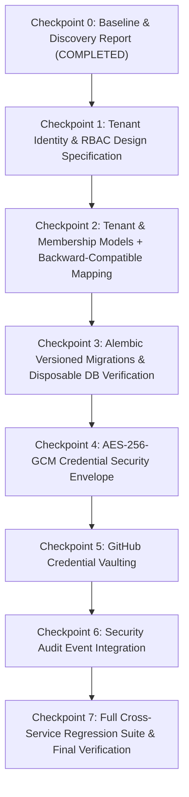

# AetherOps — Phase 1 Baseline & Discovery Report
**Document:** `PHASE1_BASELINE.md`  
**Execution Mode:** Checkpoint 0 (Discovery & Baseline Verification Only)  
**Date:** October 12, 2026  
**Status:** Completed — Paused for Review  

---

## 1. Executive Summary

This report establishes the verified baseline for **Phase 1: Multi-Tenant Identity, Role-Based Access Control (RBAC), and Cloud Credential Security Envelope** in AetherOps. 

AetherOps is an active microservices-based application designed to automate cloud infrastructure planning and deployment. Following the completion of Phase 0 (Baseline & Security Containment), this discovery audit inspects the current repository state, existing identity and authorization implementations, database topology, migration capabilities, credential storage flows, and potential backward-compatibility risks before any Phase 1 schema or cryptographic changes are enacted.

---

## 2. Repository & Runtime Baseline

| Attribute | Verified State |
| :--- | :--- |
| **Repository Path** | `/home/prathap32/GP/devops-lab/projects/aether-cloud` |
| **Current Branch** | `main` |
| **HEAD Commit** | `52bff81` (*feat(architecture): restore project, source connection, and repo analyzer modules with unified port routing*) |
| **Working Tree Status** | Phase 0 containment fixes present (unstaged changes in 5 files, 3 new untracked test suites): • `services/project_and_environment_management/app/auth.py` • `services/project_and_environment_management/app/router.py` • `services/source_and_cloud_connection/app/auth.py` • `services/source_and_cloud_connection/app/router.py` • `services/repo_analyzer_service/app/main.py` • `services/project_and_environment_management/tests/test_isolation_security.py` • `services/source_and_cloud_connection/tests/test_isolation_security.py` • `services/repo_analyzer_service/tests/test_path_sanitization.py` |
| **Python Environment** | Linux x86_64, Python 3.11.15 in `.venv`, `uv 0.11.14` |
| **Active Infrastructure** | Docker containers healthy: `aether_postgres` (Port 5432), `aether_redis` (Port 6379) |

---

## 3. Existing Identity & Authorization Architecture

### 3.1 Identity System Topology
AetherOps does not currently have a centralized identity provider or auth service. Instead, each service implements an independent authentication module with duplicated SQLite/PostgreSQL tables:
- `services/project_and_environment_management/app/auth.py` (`pm_admin_users` table in `pm_admin_security.db` / Postgres schema `project_manager`)
- `services/source_and_cloud_connection/app/auth.py` (`AdminUser` table in `sc_admin.db` / Postgres schema `source_connection`)
- `services/admin_console/app/auth.py` (`admin_security.db` / Postgres schema `admin`)
- `services/requirement_analysis/app/auth.py` (`admin_security.db`)

Authentication is multi-channel:
1. `Authorization: Bearer <JWT>` (Prioritized in Phase 0)
2. HttpOnly Cookie: `aether_session` (JWT)
3. API Key: `X-Admin-Key` (Master key fallback guarded against production defaults in Phase 0)

### 3.2 Current Tenant & Ownership Model
- **No Tenant / Organization / Workspace Abstraction:** There are zero tables, models, or schemas for Tenants or Organizations anywhere in the repository.
- **Resource Ownership:** Resources (`AetherProject`, `AetherEnvironment`, `GitConnection`, `CloudConnection`) are scoped strictly by a raw string column: `owner = Column(String(100))` populated from the JWT `sub` claim (username).
- **Identity Keying Risk:** Ownership is bound to the mutable username string (`username`), rather than an immutable UUID (`user_id`).
- **Role Model:** The `AdminUser` model has a single role column `role = Column(String(32))` with values `SUPER_ADMIN`, `ADMIN`, or `USER`. There are no tenant-scoped roles (`TENANT_OWNER`, `TENANT_ADMIN`, `TENANT_MEMBER`, `TENANT_VIEWER`).

---

## 4. Current Credential Storage & Encryption Inspection

### 4.1 Cloud Credentials (`CloudConnection`)
- **Access Key ID:** Stored as unencrypted plaintext `Column(String(128))` in the database.
- **Secret Access Key:** Hashed with bcrypt (`bcrypt.hashpw(..., rounds=10)`).
  > [!WARNING]
  > **Architectural Dead-End:** Because bcrypt is a one-way password hashing algorithm, the secret access key is permanently unrecoverable. Automated provisioning, Terraform execution, and background deployment workflows cannot retrieve the secret key to authenticate against AWS.
- **IAM Role ARN & External ID:** Stored as plaintext strings (`Column(String(300))` and `Column(String(100))`).
- **Encryption Envelope:** Completely absent. No symmetric cipher (AES-GCM), key management abstraction, or KMS integration currently exists. `cryptography` is not yet installed in the Python environment.

### 4.2 GitHub Credentials (`GitConnection`)
- **PAT Tokens:** Hashed with bcrypt into `pat_token_hash`. Plaintext tokens are not stored server-side.
- **OAuth Access Tokens:** Returned directly to browser clients in OAuth redirects or stored in browser `localStorage` (`X-GH-Token`), without encrypted at-rest server vaulting.
- **GitHub App Support:** Not yet implemented. The application currently relies on GitHub OAuth Apps or Personal Access Tokens.

---

## 5. Database Topology & Migration Capabilities

### 5.1 Dual-Database Semantics
- Each service's `database.py` defines a hybrid SQLite / PostgreSQL connection pool.
- **Testing Mode (`IS_TESTING`):** Hermetic SQLite database files with WAL mode (`test_projects.db`, `test_source_connections.db`).
- **Production Mode:** Attempts connection to PostgreSQL container (`aether_postgres`). If unreachable, falls back to local SQLite files (`projects.db`, `source_connections.db`).
- **Semantics Reality:** This is **not** an atomic dual-write system. When PostgreSQL is healthy, transactions commit exclusively to PostgreSQL; local SQLite is not updated. There is no automated bidirectional synchronization between SQLite and PostgreSQL.

### 5.2 Migration Tooling Status
- **Zero Migration Tooling:** Neither Alembic nor any alternative schema migration tool is installed or configured.
- **Schema Lifecycle:** Tables are created at service startup via `Base.metadata.create_all`. This mechanism can only create nonexistent tables; it cannot add columns, alter constraints, create indexes on existing tables, or execute versioned data migrations.
- **Operational Risk:** Introducing new columns (e.g., `tenant_id`) into existing production PostgreSQL or SQLite databases will require a versioned migration tool (such as Alembic) with clear roll-forward and rollback strategies.

---

## 6. Phase 0 Verification & Continuity

All Phase 0 security containment measures were independently re-verified:
1. `register_user` and OAuth callback default to `role="USER"` (verified).
2. `list_projects` restricts unfiltered visibility to `SUPER_ADMIN` / `root_admin` (verified).
3. Cache-aside authorization checks in `project_and_environment_management` and `source_and_cloud_connection` validate database ownership **before** returning cached objects (verified).
4. `validate_safe_repo_path` in `repo_analyzer_service` restricts root `/`, `/etc`, `/proc`, `/sys`, `/root`, `~/.ssh`, and `~/.aws` (verified).
5. All 97 service unit tests and regression tests across the codebase pass with 100% success rate.

---

## 7. Recommended Phase 1 Architecture & Design

### 7.1 Proposed Tenant & RBAC Model
To transition safely to multi-tenancy without breaking existing single-user projects:

1. **Entities:**
   - `Tenant`: `id` (UUID), `name`, `slug` (unique), `status` (ACTIVE, SUSPENDED), `created_at`, `updated_at`.
   - `TenantMembership`: `id` (UUID), `tenant_id` (FK), `user_id` (FK / stable ID), `role` (`OWNER`, `ADMIN`, `MEMBER`, `VIEWER`), `created_at`.
   - `TenantContext`: Context-aware middleware deriving tenant scope from JWT claims or `X-Tenant-ID` header, with mandatory membership verification.

2. **Backward-Compatible Ownership Migration:**
   - Every existing `AetherProject`, `GitConnection`, and `CloudConnection` currently owned by `owner = "<username>"` will be mapped to a default personal tenant: `Tenant(name="<username>'s Workspace", slug="personal-<username>")`.
   - The user is granted `OWNER` role in their personal tenant.
   - Resource tables add `tenant_id = Column(String(36), nullable=True)` to allow seamless migration before enforcing strict `NOT NULL` foreign keys.

3. **RBAC Permission Matrix:**
   | Role | Project Create/Update | Git / AWS Connect | Credential Vault Access | Member Management | Platform Superadmin |
   | :--- | :---: | :---: | :---: | :---: | :---: |
   | **PLATFORM SUPER_ADMIN** | View All | Audit Only | Audit Only | System-wide | Yes |
   | **TENANT OWNER** | Yes | Yes | Yes | Full (Invite/Remove/Roles) | No |
   | **TENANT ADMIN** | Yes | Yes | Yes | Manage Members | No |
   | **TENANT MEMBER** | Yes | View Only | Use via Runner | None | No |
   | **TENANT VIEWER** | Read-Only | Read-Only | Denied | None | No |

### 7.2 Credential Security Envelope (AES-256-GCM)
Replace the one-way bcrypt hashing with a reversible, authenticated envelope encryption design:
1. **Cipher:** AES-256-GCM using standard 96-bit cryptographically secure nonces and 128-bit authentication tags (via `cryptography.hazmat.primitives.ciphers.aead.AESGCM`).
2. **Associated Authenticated Data (AAD):** Cryptographically bind ciphertext to tenant context:
   `AAD = f"tenant:{tenant_id}|resource:{connection_id}|type:{credential_type}|v1"`
   This prevents ciphertext swapping across tenants or resources.
3. **Key Management Provider Abstraction:**
   - `KeyProvider` interface:
     - `DevelopmentKeyProvider`: Derives 256-bit root key from external environment variable (`AETHER_MASTER_ENCRYPTION_KEY`). Fails closed if absent.
     - `KmsKeyProvider`: Generates and decrypts envelope data keys via AWS KMS `GenerateDataKey` / `Decrypt` for production deployments.
4. **Credential Vault Model:**
   - `SecretStore`: `id`, `tenant_id`, `resource_type`, `resource_id`, `ciphertext`, `nonce`, `tag`, `key_id`, `version`, `created_at`.

---

## 8. Potential Backward-Compatibility & Engineering Risks

1. **Deterministic Sizing & Architecture Preservation:**
   - `services/requirement_analysis`: 39 regional SQLite pricing catalogs and sizing math must remain untouched.
   - `services/architecture_generator`: DAG node coordinates, schemas, and graph topology must remain untouched.
2. **API Contract Compatibility:**
   - Endpoints like `GET /api/v1/projects` and `GET /api/v1/cloud/connections` must continue returning existing fields (`id`, `name`, `owner`, `status`) to avoid breaking UI or gateway proxies.
3. **Database Migration Dependencies:**
   - Introducing Alembic requires adding `alembic` to `pyproject.toml` and configuring migration environments for both PostgreSQL and SQLite.

---

## 9. Proposed Implementation Sequence

---

## 10. Checkpoint 0 Conclusion

Checkpoint 0 discovery is complete. No production mutations or irreversible code changes were made. 

**Execution is paused here per Section 17 operating instructions. Awaiting review and explicit approval before proceeding to Checkpoint 1.**
