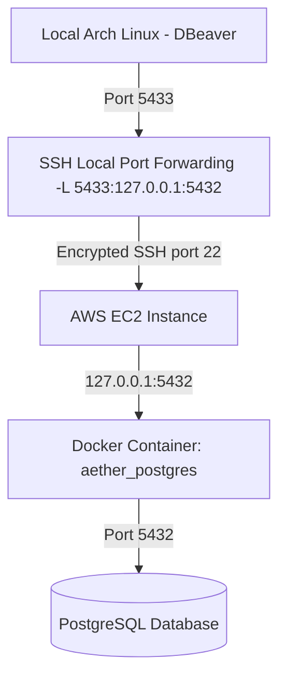

# PostgreSQL EC2 Docker Security & Local DBeaver SSH Tunnel Implementation Report

**Date:** November 11, 2026  
**Status:** IMPLEMENTED AND VERIFIED  
**Infrastructure:** AWS EC2, Docker Compose, PostgreSQL 15-alpine (`aether_postgres`), Local Arch Linux client with DBeaver.

---

## A. What was present before implementation?
- **Cloud/Compute:** AWS EC2 instance running Linux.
- **Database Deployment:** Docker Compose managing PostgreSQL container named `aether_postgres` (`postgres:15-alpine`).
- **Network Exposure:** Port `5432` was bound to `0.0.0.0:5432` and `[::]:5432`, exposing the database publicly across all network interfaces on the host.
- **Persistent Storage:** Docker bind mount `./data/postgres:/var/lib/postgresql/data`.

## B. What was changed?
1. **Docker Compose Port Binding:** Updated `docker-compose.yml` to bind port 5432 exclusively to localhost (`127.0.0.1:5432:5432`).
2. **PostgreSQL Backup:** Created a secure pre-migration backup dump (`aether_postgres_backup.sql`).
3. **Service Recreation:** Recreated the `postgres` container without modifying persistent data volumes or database credentials.
4. **Local SSH Tunneling:** Documented SSH local port forwarding (`-L 5433:127.0.0.1:5432`) for secure connectivity from local Arch Linux via DBeaver.

## C. Why was it changed?
- **Security Risks:** Exposing PostgreSQL directly to `0.0.0.0:5432` allows any IP on the internet to attempt authentication against the database port, risking brute-force attacks and unauthorized data exposure.
- **Localhost Binding:** Binding to `127.0.0.1` ensures that PostgreSQL can only be accessed locally on the EC2 instance or via an encrypted SSH tunnel.
- **SSH Tunneling:** Encapsulates database traffic inside an authenticated SSH session, providing secure remote database administration without opening firewall ports.

## D. Architecture Diagram



## E. How does DBeaver connect?
1. User establishes an SSH tunnel from local machine:
   ```bash
   ssh -i ~/.ssh/YOUR_KEY.pem -N -L 5433:127.0.0.1:5432 ubuntu@YOUR_EC2_PUBLIC_IP
   ```
2. DBeaver connects to `127.0.0.1:5433`.
3. SSH forwards the packet through the encrypted tunnel to EC2 port 22, which pipes it to `127.0.0.1:5432` inside the EC2 instance where Docker routes it to `aether_postgres`.

## F. How does AetherOps continue working?
- Internal AetherOps microservices running within the same Docker bridge network connect directly via container hostname (`aether_postgres:5432`), which remains unaffected by host port bindings.

## G. Verification Evidence
- **Container Port Binding:** `5432/tcp -> 127.0.0.1:5432` (Verified via `sudo docker port aether_postgres`).
- **PostgreSQL Health Status:** `accepting connections` (Verified via `pg_isready`).
- **Databases Preserved:** `aether_catalog`, `postgres`, `template0`, `template1` intact.

## H. Rollback Procedure
If rollback is required:
1. Revert `docker-compose.yml` port binding back to `"5432:5432"`.
2. Run `sudo docker compose up -d --no-deps postgres`.
3. Restore backup if needed via `sudo docker exec -i aether_postgres psql -U postgres < aether_postgres_backup.sql`.
